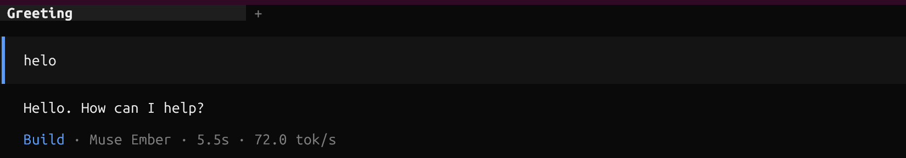

# opencode-plugin-muse

Use Muse models in [opencode](https://opencode.ai) with the `muse` CLI login you
already have. Muse models appear in the model picker as the `muse` provider, and
requests go through the signed-in `muse` CLI, so no Muse credential reaches opencode
or your config.

Tested with Muse CLI 1.4.24 and opencode 2.3.2. Republished build of
[`@rasyid_rafi/opencode-muse`](https://www.npmjs.com/package/@rasyid_rafi/opencode-muse)
with five patches: [`CREDITS.md`](CREDITS.md) has the diffs, `docs/provenance.md` the
build hash and what it does and does not prove. The first two reconcile the published
0.1.9 tarball; the third contains Muse to inference, the fourth makes opencode own
the context, and the fifth finishes the effort, prompt, and rewritten-history
boundaries. None of the last three is published yet.

Not affiliated with Meta or opencode. Best-effort maintenance by one person, with no
support commitment.


## What it does

- registers the `muse` provider (labelled "Muse Code") with `muse-ember-1.0`,
  `muse-wonder-1.0`, `muse-spark-1.3`, and `muse-spark-1.2`, usable as a main or
  subagent model
- implements `LanguageModelV3`, translating opencode turns into Muse CLI sessions
- runs a loopback-only MCP server (`127.0.0.1`, random port, per-start bearer token)
  so Muse can call opencode's tools
- starts `muse serve` with a private config: Muse's built-in tools and any MCP servers
  from your Muse config are off, its base prompt is replaced by a short control prompt,
  and every tool call has to cross the bridge, so opencode's permissions and history
  stay authoritative
- forwards `museAgent` and `museInstructions` as session developer instructions, so
  the first user turn stays the user's message
- maps opencode's reasoning-effort variants to Muse's per-turn effort (`default` omits
  the field), and answers titles and compaction locally instead of spending a Muse turn
- starts Muse with its skills, observer reminders, workflow triggers, and context
  messages off, then reseeds a rewritten transcript from the full prompt; a native
  fork measured 2.4x the fresh input and 1.9x the total input of a reseed, so the
  plugin does not fork
- leaves the history decisions to opencode. Opencode decides when to compact and
  when to fork; the plugin answers the compaction hook locally and can return a
  native replacement window, so the next turn continues the same Muse session
  instead of reseeding. The summary is the same digest, so a model switch or a
  dropped window still has the facts. A rebuilt native session sees the prompt it
  is handed, tool calls and results included. The plugin keeps a local token
  ledger (`usage-*.jsonl` under `$XDG_STATE_HOME/opencode-muse`) so token use and
  reseed reasons stay measurable

Muse Code authenticates in its own CLI. Meta attests the Muse Code client: a subscription
covers requests that client makes, and `api.meta.ai` refuses requests carrying a
subscription key from anything else (`permission_error`,
`code: client_attestation_denied`). So the plugin drives the signed-in CLI (`muse serve`,
via `@muse-code/sdk`) instead of calling the model API itself. It never holds Muse
credentials, and the API key it reports to opencode is a placeholder that is never sent
to Muse.

Which credential that CLI spends is not visible from inside the process: a
subscription and a pay-as-you-go Meta Model API key look the same, and no field on
the wire reports it. `muse usage` is the only meter, and it reports account-wide
percentages rather than a per-turn cost.

## Limits of the seam

- **Sampling.** Muse's session protocol has no temperature, top-p, top-k, max
  tokens, stop, or seed field. The models are registered as not accepting a
  temperature, and opencode settings that only change sampling do not reach the
  model.
- **Contributor mode.** The plugin starts `muse serve` with
  `--contributor-mode off`, so your code is not used for training. Muse's own
  default for a subscription is Contributor Services: training on, and less
  allowance spent. `MUSE_CONTRIBUTOR_MODE=1` restores that default (the value
  Muse's own docs use; `on` and `true` are accepted too). The choice is per
  plugin run, because the plugin hands Muse its own config directory, so the
  setting in your own Muse config is not read.
- **Containment.** Muse's built-in tools, observer reminders, workflows, and
  skill catalog are off, and its toolset is pinned to the bridge, so the model's
  tool surface is opencode's and every call crosses opencode's permission
  engine. That covers the model, not the workspace. The plugin grants workspace
  trust because the bridge does not start without it: a repo's
  `.muse/hooks.json` commands and project skills then load outside opencode's
  permissions, and its `.agents/memory/MEMORY.md` enters the prompt even in an
  untrusted workspace. The startup warning names the hooks and skills when a
  repo supplies them.
- **Model catalog.** The catalog is a snapshot taken at startup. Muse's session
  protocol has no catalog subscription, so a model added or newly entitled in
  Muse appears only after opencode restarts; contributor variants are read from
  Muse's on-disk catalog and merged in, with their labels presentation-only.

## What a turn looks like

One turn end to end. opencode draws the model label, the latency, and the throughput
from the provider, so the line under the reply is the plugin reporting back:



## Native history

`MUSE_NATIVE_HISTORY=1` turns on the compaction hook's native replacement
window; it is off by default and stays opt-in by policy. No value has been
measured in the unit the subscription bills: `muse usage` reports account-wide
percentages that a turn does not move, so the decision is policy, not a number.

The authority is deliberately split: opencode owns the loop, tools, permissions,
session ids, forks, rewinds, and the compaction decision; Muse owns the native
inference transcript between compactions. The native session is a cache. The
compaction digest is the portable fallback and is used as the summary too, so a
model switch, a dropped window, or a refused resume still has the facts.

The ten-session smoke test showed 5/5 old sessions reseeding after compaction and
0/5 new ones, the old arm starting a new native session each time and the new arm
keeping one throughout. That is a mechanism result, not a recall result. Gate A
placed the vault code past the digest's clip: the new arm recalled it 5/5 with
one native row and no reseed each, while one old-arm control missed it and kept
the control. Gate B added 29 sessions with 0 failures, a 9.81% one-sided upper
bound on the miss rate rather than a zero-rate claim. Automatic and background
compaction, restart, model switch, second compaction, fork, and tool-result
recall behave as documented; a mid-turn compaction keeps the tool exchange in
flight instead of dropping to the digest. A 44-turn sweep showed no attributable
saving, but it excluded the summarizer call, so it cannot settle value.

opencode's rules reach the model as flattened text by default. The host does
install a per-session developer prompt, so that is a policy choice, not a
limitation. Containment is enforced on the observable surface: the session record
shows the control prompt installed from settings, Muse's own reminders, skills,
and delegation off, and a bridge-only toolset. It covers the model, not the
workspace; [Limits of the seam](#limits-of-the-seam) says what that leaves out.
Gate design, numbers, and what they do not show:
[`docs/native-history-evidence.md`](docs/native-history-evidence.md); the wire
contract is [`docs/compatibility.md`](docs/compatibility.md).

## Install

```bash
opencode plugin add @jonathand34/opencode-plugin-muse
```

If that fails (some opencode builds currently error in their embedded installer with
`NpmInstallFailedError`), install the package yourself and point a plugin file at it,
which is what opencode loads:

```js
// ~/.config/opencode/plugins/muse.js
export { default } from "@jonathand34/opencode-plugin-muse";
```

Requirements: opencode 2.x (the plugin targets the V2 plugin API in
`@opencode/plugin`); Muse Code CLI 1.4.20 or newer, already logged in; Node >= 22 for
the build and bun >= 1.4.4 for the tests. Runtime dependencies are
`@ai-sdk/provider@3.0.8`, `@muse-code/sdk@1.4.24`, and `@opencode/plugin@2.3.2`.

If the CLI is missing or signed out, model discovery fails and the provider has no
models; the plugin logs `model discovery failed` with the reason.

## Environment

The plugin reads these when it starts, so a change takes effect on the next
opencode start. `MUSE_CAPABILITIES` and `MUSE_REMINDERS` also appear in the source
as constant names, and `MUSE_NO_AUTO_UPDATE` is set by the plugin on its child
host; none of the three is a setting you can pass.

| Variable | Default | Effect |
|---|---|---|
| `MUSE_BIN` | `muse` | CLI the plugin spawns |
| `MUSE_PRESET` | private config dir; `empty` if it could not be written | preset the host runs with |
| `MUSE_CONTAINMENT` | `warn` | `strict` refuses to start on a critical containment failure; `off` skips the checks |
| `MUSE_CONTRIBUTOR_MODE` | off | `1`, `true` or `on` restores Muse's contributor routing for this host |
| `MUSE_NATIVE_HISTORY` | off | same values; installs native compaction windows |
| `MUSE_STRICT_HOST` | off | `1` refuses a host whose schema drifted |
| `MUSE_PROBE_PROMPT` | off | `1` probes developer-prompt delivery at startup |
| `MUSE_CONTEXT_LIMIT` | unset; then model field, table, 128k | when set it wins over the model's own field |
| `MUSE_OUTPUT_LIMIT` | unset; then model field, table, 8,192 | when set it wins over the model's own field |
| `MUSE_SESSIONS_ROOT` | host `museHome`, then `<XDG_DATA_HOME>/muse/sessions` | where the containment report reads the host's toolset record |
| `MUSE_DEBUG_CONTAINMENT` | off | `1` prints the containment report at startup |

## Verify the build

```bash
bash scripts/repro.sh
```

It installs from the committed lockfile, compiles, and compares the resulting `dist/`
against the hash recorded for this tree in `docs/provenance.md`. It prints `PASS` or
exits non-zero; on this tree it currently exits non-zero, because the recorded hash
predates patches 3 through 5 (see `docs/provenance.md`). The hash of the published
0.1.9 tarball is recorded there too.

```bash
npm run check:offline   # typecheck plus the offline test suite
```

`npm run check:offline` runs 290 tests that need no network or credentials. `bun test`
adds six live suites (`tool-bridge`, `containment-live`, `fork-live`, `model-live`,
`conformance`, `restart-live`) that spawn a real `muse serve` host, all needing a
logged-in Muse Code CLI. One reuses a tool result on the next turn; another resumes a
session after its host has been restarted; `containment-live` proves the host sees
only bridge tools.

Those live suites pass `contributorMode: "off"` for the same reason the plugin does.
The `empty` preset turns contributor mode on, which routes every model to its
`-contributor` variant, and `muse-ember-1.0` has none, so the model request fails with
`code: "modelError"` unless the flag is set. Production does not use that preset; it
uses the private config, and `empty` remains only as a fallback when the config cannot
be written.

## Verify the published package

The npm package is built and published by `.github/workflows/publish.yml` on
GitHub Actions, and every version carries a provenance attestation. After
installing, two checks tie the bytes you have to that workflow:

```bash
npm audit signatures          # registry signatures and attestations
```

To match the tarball against the attestation yourself, compare the two digests.
The registry reports base64, the attestation reports hex:

```bash
npm view @jonathand34/opencode-plugin-muse@0.1.12 dist.integrity

curl -sS -A npm/11.19.1 \
  "https://registry.npmjs.org/-/npm/v1/attestations/@jonathand34%2fopencode-plugin-muse@0.1.12" \
  | jq -r '.attestations[] | select(.predicateType=="https://slsa.dev/provenance/v1")
      | .bundle.dsseEnvelope.payload' \
  | base64 -d | jq -r '.subject[0].digest.sha512'
```

What the attestation establishes: the tarball was built by this repository's
`publish.yml` at `refs/heads/main` on a GitHub-hosted runner, and it names the
workflow run. That is SLSA Build Level 2 — it shows where the bytes came from,
not that they are free of bugs. The plugin never holds credentials; it drives
the signed-in `muse` CLI.

The attestation endpoint needs an npm-style `User-Agent`. A bare `curl` gets a
404.

## Layout

```text
src/        upstream source plus the patches in docs/provenance.md
test/       test suite (upstream tests plus this fork's)
docs/       compatibility.md, native-history-evidence.md, provenance.md
            (native-history.md and steady-state.md are kept locally, not published)
bench/      preregistered gates, experiments, execution record; kept locally
evidence/   inputs for the reproduction check (diffs, measurements); kept locally
scripts/    repro.sh and the native-history gate scripts
media/      README screenshots
```

## Licence

MIT, same as upstream. See `LICENSE` and `CREDITS.md`.
