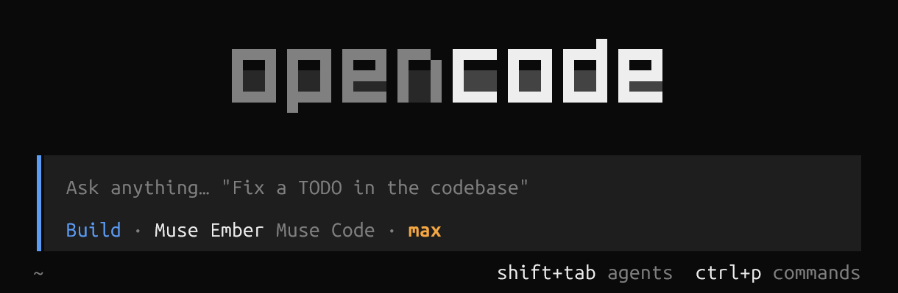

# opencode-plugin-muse

Use Muse models in [opencode](https://opencode.ai) with the `muse` CLI login you
already have. Muse models appear in the model picker as the `muse` provider, and
requests go through the signed-in `muse` CLI, so no Muse credential reaches opencode
or your config.

Tested with Muse CLI 1.4.24 and opencode 2.3.2. Republished build of
[`@rasyid_rafi/opencode-muse`](https://www.npmjs.com/package/@rasyid_rafi/opencode-muse)
with five patches: [`CREDITS.md`](CREDITS.md) has the diffs, `docs/provenance.md` the
build hash and what it does and does not prove. The first two reconcile the published
0.1.9 tarball; the third contains Muse to inference, the fourth makes opencode own
the context, and the fifth finishes the effort, prompt, and rewritten-history
boundaries. None of the last three is published yet.

Unofficial: not affiliated with, endorsed by, or supported by Meta or opencode.
Best-effort maintenance by one person, with no support commitment. It never holds
Muse credentials and writes one file of its own (the token ledger); everything else
it keeps is in memory.



## What it does

- registers the `muse` provider (labelled "Muse Code") with `muse-ember-1.0`,
  `muse-wonder-1.0`, `muse-spark-1.3`, and `muse-spark-1.2`, usable as a main or
  subagent model
- implements `LanguageModelV3`, translating opencode turns into Muse CLI sessions
- runs a loopback-only MCP server (`127.0.0.1`, random port, per-start bearer token)
  so Muse can call opencode's tools
- starts `muse serve` with a private config: Muse's built-in tools and any MCP servers
  from your Muse config are off, its base prompt is replaced by a short control prompt,
  and every tool call has to cross the bridge, so opencode's permissions and history
  stay authoritative
- forwards `museAgent` and `museInstructions` as session developer instructions, so
  the first user turn stays the user's message
- maps opencode's reasoning-effort variants to Muse's per-turn effort (`default` omits
  the field), and answers titles and compaction locally instead of spending a Muse turn
- starts Muse with its skills, observer reminders, workflow triggers, and context
  messages off, then reseeds a rewritten transcript from the full prompt; a native
  fork measured 2.4x the fresh input and 1.9x the total input of a reseed, so the
  plugin does not fork
- leaves the history decisions to opencode. Opencode decides when to compact and
  when to fork; the plugin answers the compaction hook locally and can return a
  native replacement window, so the next turn continues the same Muse session
  instead of reseeding. The summary is the same digest, so a model switch or a
  dropped window still has the facts. A rebuilt native session sees the prompt it
  is handed, tool calls and results included. The plugin keeps a local token
  ledger (`usage-*.jsonl` under `$XDG_STATE_HOME/opencode-muse`) so token use and
  reseed reasons stay measurable

### Why `muse`, not `meta`

opencode's catalog has a `meta` provider, and a plugin can register an auth hook
for it; the competitor that does so mints an inference key and keeps it in
opencode's auth store. This plugin cannot take that route without holding a
credential it exists not to hold. It registers its own `muse` provider, owns the
model list and limits, and leaves sign-in to `muse login`. The provider declares
`canonical: "meta"`, so opencode's catalog supplies defaults where the plugin's
table is silent; the model list stays the plugin's. The cost is UX parity:
`/connect` does not list it, and a model switch is a picker entry rather than an
account connection. The benefit is that the credential never reaches opencode,
the config, or this plugin. The MSP competitor also registers `muse`, so the
split is about the credential, not the id.

Muse Code authenticates in its own CLI. Meta attests the Muse Code client: a subscription
covers requests that client makes, and `api.meta.ai` refuses requests carrying a
subscription key from anything else (`permission_error`,
`code: client_attestation_denied`). So the plugin drives the signed-in CLI (`muse serve`,
via `@muse-code/sdk`) instead of calling the model API itself. It never holds Muse
credentials, and the API key it reports to opencode is a placeholder that is never sent
to Muse. A denial fails the turn with Muse's own message intact and stays a protocol
error: it is not an auth error, and logging in again does not clear it.

### The subscription credential

Meta's Model API Terms, §3.2, restrict the credential a Coding Harness
Subscription connects to the coding harness: it "may not be used to access the
Services outside the coding harness or to circumvent your subscription's usage
limits or billing." This plugin never receives that credential. It spawns the
signed-in `muse` CLI and speaks MSP to it over stdio, so every request is made by
Muse Code's own process under the account's own subscription; the API key
opencode sees is a placeholder that is never sent to Meta. The plugin does not
extract, cache, or forward a token, and it adds no login flow of its own. That is
the mechanism the terms describe, not a claim that Meta has endorsed this
arrangement: Muse's subscription documentation says the credential is "for use
with Muse Code only", and the SDK is a developer preview, so the arrangement can
be restricted at any time. If it is, the failure is a refused turn, not a leaked
credential.

Which credential that CLI spends is not visible from inside the process: a
subscription and a pay-as-you-go Meta Model API key look the same, and no field on
the wire reports it. `muse usage` is the only meter, and it reports account-wide
percentages rather than a per-turn cost.

## Limits of the seam

- **Sampling.** Muse's session protocol has no temperature, top-p, top-k, max
  tokens, stop, or seed field. The models are registered as not accepting a
  temperature, and opencode settings that only change sampling do not reach the
  model.
- **Contributor mode.** The plugin starts `muse serve` with
  `--contributor-mode off`, so your code is not used for training. Muse's own
  default for a subscription is Contributor Services: training on, and less
  allowance spent. `MUSE_CONTRIBUTOR_MODE=1` restores that default (the value
  Muse's own docs use; `on` and `true` are accepted too). The choice is per
  plugin run, because the plugin hands Muse its own config directory, so the
  setting in your own Muse config is not read.
- **Containment.** Muse's built-in tools, observer reminders, workflows, and
  skill catalog are off, and its toolset is pinned to the bridge. The asymmetry
  is deliberate: MCP tools stay on through Muse while Muse's own tools stay off,
  and subagents and workflows stay disabled — a smaller surface with the same
  reach is the whole point of the bridge. Their spawner tools are outside the
  pinned toolset, a child would be a billed call whose own context opencode never
  sees, and spawning belongs to opencode. It is not that a child would escape the
  gate: Muse's children inherit the lead session's tools and permission boundary
  and cannot widen them. So the model's tool surface is opencode's and every call
  crosses opencode's engine. That covers
  the model, not the workspace. The plugin grants workspace
  trust because the bridge does not start without it: a repo's
  `.muse/hooks.json` commands and project skills then load outside opencode's
  permissions, and its `.agents/memory/MEMORY.md` enters the prompt even in an
  untrusted workspace. Muse runs with `allowAll`, and that is structural rather
  than a shortcut: this plugin holds no tool executor of its own, so a bridged
  call is emitted into opencode, which decides and runs it — there is no private
  pre-check here to bypass, and the gate is opencode's (`allowAll`'s vendor
  justification is the same boundary: the client already holds the user's
  ambient authority). The bridge's denial path is pinned by a test. `allowAll`
  is measured, not assumed: `denyUnmatched` refuses every bridged call
  (`deny_unmatched: no policy rule allows this action`), because Muse's saved
  rules are command-prefix scoped and cannot name an MCP tool. Approval is
  not the only layer, but the layers are not stacked here. The stack is one gate
  and one allowlist. Every bridged call is emitted into opencode, which decides
  and runs it, so the gate is opencode's permission rules; the allowlist is
  `mcp__opencode__*`, which limits what Muse may ask for, not what the granted
  tools do. There is no isolation behind that gate. opencode ships no OS sandbox
  — its own documentation says `shell` "runs with the host user's filesystem,
  process, and network authority" — and every agent starts from a base policy
  that allows everything except `.env` reads. Muse's sandbox cannot cover a
  bridged call for the same reason it does not cover opencode's own tools: the
  call executes in opencode's process, and the pinned toolset has no shell tool
  for Muse to fence. A managed Muse plane is not a layer either, and the reason
  is narrower than it looks: Muse's 1.4.2 changelog describes a managed policy
  that restricts permission profiles (`muse serve` refuses and lists the allowed
  ones), but on 1.4.25 the `policy` plane still admits no member, the `defaults`
  plane's four members all report `user_overridable=true`, and this plugin's
  private `settings.json` is a user file. The behaviour ships and the local
  document does not express it; if one is ever delivered, the encounter is a
  refused start, not a rule this plugin can read. So the promise is visibility
  and vetoability, not containment:
  every call crosses opencode's transcript and its rules. The hard stop that
  survives `--auto`, or an agent whose rules allow everything, is a configured
  `deny` — saved approvals never override one — and the one above it is a
  `policies` statement, which outranks saved approvals as well as `--auto` and
  never prompts. Repo-supplied
  Muse hooks (`project` handlers) are refused
  when a session opens: the host names every installed handler's origin, and a
  workspace file is accepted only after its exact hash is recorded
  (`bun run doctor --trust-hooks`). `MUSE_ALLOW_PROJECT_HOOKS=1` accepts it for
  one run instead. A `plugin` handler is allowed: every install scope writes
  into your own store, so it is code you installed and approved rather than a
  file a checkout can plant, and the doctor prints each handler's origin.
  Skills stay a startup warning, because they are instructions rather than
  commands.
- **Timeouts.** A host that stops answering is ended, not waited on: no first
  frame within 900 s, or 180 s of silence after frames have started, fails the
  turn as a timeout, asks the host to interrupt with a 2 s budget, closes the
  host, and the next turn resumes the same native session. The clock measures
  the phase it is in: a bridged tool call in flight suspends the idle clock
  (that silence is opencode's tool, not the host) and is declared to the host as
  an external wait, so a client can show what is running; a provider retry
  extends the clock by the delay the host reports, capped at 10 minutes and
  never past the attempt count the host itself sets. The wait declaration is a
  status signal, not a lease: it is dropped when the host restarts and by your
  next input (a resume that re-attaches to the same live host keeps it, measured
  2026-11-22), and it does not keep an idle session alive. A warning is logged
  after 90 s of silence. Each budget is env-tunable and `0` disables it. On
  Windows the shutdown ladder has no graceful rung — Node's `SIGTERM` is a
  forceful kill there — so the host is ended after the drain window rather than
  asked to stop; the doctor's `platform` row prints the ladder this machine
  actually has.
- **Posture and ceilings.** The plugin pins no permission profile and does not
  declare Muse's beta capability, so it cannot read the posture its own session
  runs under: `permissionState` and the profile catalog are served only to a
  client that opts into `experimentalApi`. `bun run doctor` does declare it, on
  its own connection, and prints the profile Muse would start under, its axes and
  the catalog. The axes govern Muse's own shell, not the calls the plugin
  bridges. That row is a read, not a promise — saved approvals and any managed
  policy are invisible to it, and a policy that denies this plugin is invisible
  in the same way: the plugin is not loaded, and the turn fails as `Model
  unavailable` rather than as a policy. For a turn ceiling the plugin adds none: a
  client-side cap would fire after the spend it exists to prevent. opencode's
  `agent.<name>.steps` is the knob that exists, off by default, enforced in
  opencode's own prompt loop, and it does count a turn this plugin drives; the
  fragment is under **A ceiling for an unattended run**.
  The durable ceiling is the provider's own limit, which the allowance warning
  approaches before it is reached.
- **Model catalog.** The catalog is a snapshot taken at startup. Muse's session
  protocol has no catalog subscription, so a model added or newly entitled in
  Muse appears only after opencode restarts; contributor variants are read from
  Muse's on-disk catalog and merged in, with their labels presentation-only.
- **Deployment.** One host per user. The plugin spawns its own `muse serve` over
  stdio, so there is no shared host, no remote host, and no socket to one. That
  per-user stdio channel is also why the vendor's attestation model holds: the
  host is the signed-in CLI of the person using it.
- **Accounts.** One signed-in identity per host. Switching accounts means
  `muse logout` and a fresh login before opencode restarts; the plugin has no
  account switch and never sees the credential.
- **Network.** A turn needs a live host, which needs the vendor. There is no
  offline or air-gapped path, and no local inference fallback.
- **Attachments.** Images only. The wire's attachment vocabulary is `"image"` in
  v1, so a PDF or a text file has no surface to travel on and
  `acceptsFiles: false` is the wire, not a policy.
- **Platforms.** Built and tested on Linux. The offline suite is configured to
  run on macOS and Windows as well, but that workflow has never been dispatched —
  it exists only on a local branch ahead of the default one, so a dispatch is a
  404 until this tree is pushed — and Windows is best-effort with three named
  caveats: the shutdown ladder has no
  graceful rung, the ledger and the hook trust record carry an inherited ACL
  rather than `0600` (Windows `chmod` changes only the write bit), and the
  vendor's sandbox may ask for UAC consent when it initialises — a headless spawn
  cannot answer that, and it surfaces 900 s later as `host_idle_timeout`. The
  doctor's `platform` row states all three for the machine it runs on.

### A hard stop, if you want one

opencode's base policy allows everything but `.env` reads, so a fresh install
stops nothing a bridged call might do. Two mechanisms stop it, and they are not
interchangeable. `policies` is the recommended one: a statement is binary, never
prompts, and is applied after agent rules and saved approvals, so neither
`--auto` nor an "Allow always" outranks it. `permissions` is the per-agent form,
further down, and it is the one to reach for when you want a prompt rather than
a block.

Two `policies` statements reach this plugin, and both were measured on
2026-11-23:

```jsonc
// opencode.jsonc
{
  "policies": [
    { "action": "plugin.use", "resource": "/home/you/src/opencode-plugin-muse", "effect": "deny" },
    { "action": "provider.use", "resource": "muse", "effect": "deny" }
  ]
}
```

Each works, and each is silent about itself. The first means the plugin is not
loaded at all, however it was configured; the second means it loads and its
provider is hidden. Either way the turn fails with `Model unavailable:
muse/muse-spark-1.3` — the sentence a typo in the model id also produces — while
`opencode models` goes on listing the models, because the catalog is not the
policy. If a turn failed and the message says the model is unavailable, a policy
is one of the reasons.

A statement that fails validation is dropped, not rejected: the host writes a
warning to the server log, applies the rest of the list, and — because nothing
matching means the action is allowed — leaves a typo in an action or effect name
indistinguishable from having written no policy at all. So check the log after
editing a `deny`, and prove the deny by its effect: a turn that should have been
stopped and was not is the signal, and a typo produces exactly the same silence.
`bun run doctor` closes the local half of that gap: its `policies` row spawns
`opencode --print-logs debug config` and reads this run's own stderr, then reports
each `configuration normalization diagnostic` with the statement's pointer and
the host's own action. It says `ok` only when that output carried a structured
log line and reported no drop; a run that printed no log output is `skipped`
rather than `ok`. A file the host refuses outright is not printed at all, so the
doctor reports it once in a `config` row and the `policies` and `plugins` rows
defer to it instead of naming a cause that is not the cause. Attribution is the
stream, not a list of paths, so a rejected file in a directory above the working
one is reported too — the host merges every ancestor config it finds. That is the local path only. A policy delivered by
Console is decoded on the vendor's side and unknown actions and effects are
filtered without a diagnostic (`anomalyco/opencode#60252`), so on a managed
machine there is no log line to check and the effect is the only evidence.

`tool.use` is the denial that names itself. Its resource is `<action>:<value>`,
matched against every check the tool makes, so `read:*` covers every read and
`opencode_bash:*` the bridged shell:

```jsonc
{ "policies": [{ "action": "tool.use", "resource": "read:*", "effect": "deny" }] }
```

A denied check fails with `Blocked by configuration policy`, the model receives
it as a tool error, and the turn continues: in the measured run the model
retried with a relative path, then used `glob` and `grep` to read the same file
and answered. Expect a refusal the model can route around, not a wall — and not
a content boundary either, since `grep` read what `read` was refused.

`permissions` is the other form: per agent, ordered, last match wins, and able
to `ask`. In opencode's V2 vocabulary an MCP tool's action is `<server>_<tool>`,
and the bridge's server is named `opencode`, so the bridged shell is
`opencode_bash` — not `shell`, which is opencode's own tool:

```jsonc
// opencode.jsonc
{
  "$schema": "https://opencode.ai/config.json",
  "permissions": [
    { "action": "opencode_bash", "resource": "*", "effect": "deny" }
  ]
}
```

That blocks the bridged shell at opencode's gate and leaves opencode's own tools
alone. The same rule with `opencode_edit` or `opencode_read` denies those too;
all three together leave Muse with no tools, which is a coherent posture but not
a useful default. A narrower `resource` names a path or a command prefix.

Muse's permission profile is the other half, and it is yours, not the plugin's:
the plugin pins none, so a session runs whatever your default is. `Unrestricted`
records `approval: allowAll, filesystem: unrestricted, network: enabled`
(measured on 1.4.25). The plugin never passes `--disable-sandbox` — under the
pinned toolset Muse owns no shell tool for its sandbox to fence — and it does not
turn a profile back on either.

### A ceiling for an unattended run

The plugin adds no cap: a client-side one would fire after the spend it exists to
prevent, and the plugin cannot see a step before it costs anything. opencode has
the knob, per agent:

```jsonc
// opencode.jsonc
{
  "$schema": "https://opencode.ai/config.json",
  "agent": { "build": { "steps": 12 } }
}
```

`steps` is a positive maximum, unset by default, enforced in opencode's own
prompt loop, and it counts a turn this plugin drives (measured 2026-11-23).
**One step is one model request**, so a turn that uses N tool calls needs N+1
steps: two reads and a reply took exactly three (measured 2026-11-23). On the
last step opencode keeps the tool list, sets `toolChoice` to `none`, and appends
an instruction to answer in text, so that request can summarise but cannot act.

The smallest value is a trap. `steps: 1` gives the model one request with no
tools allowed: the turn answers with the "maximum steps reached" summary and does
nothing else (measured 2026-11-23: 118 output tokens, no tool calls). The
published 0.1.12 returns nothing at all from that step — the trailing
instruction never reaches Muse, so the run prints nothing, reports zero tokens,
and exits 0. This tree fixes it; the fix is not released. Give it the number of
steps you would accept, not 1.

### Headless runs

`opencode run` works under two conditions — one entry for this package, and
`steps` above 1 if the turn has anything to do. A scripted turn with the
checkout as the only plugin produced text and three bridged tool calls (measured
2026-11-23). Break either condition and the turn does no work.

- **`steps: 1`** answers with the step-cap summary and makes no tool call, as
  above — in this tree. The published 0.1.12 returns nothing.
- **Two entries for one package.** opencode loads one instance per package name
  and the first entry wins. A global `@jonathand34/opencode-plugin-muse` in
  `~/.config/opencode` is merged ahead of a project's
  `plugin: ["/path/to/checkout"]`, so the published build runs and the checkout
  never starts — while the log still prints `loading plugin` for the checkout.
  If you are testing local changes, drop the package entry, or point
  `XDG_CONFIG_HOME` at a config that lists only the checkout.

When a second entry shadows the checkout, a turn produces nothing and prints
nothing: zero bytes on stdout, exit code 0. The plugin cannot help with that one
— no request reaches it, so no hook runs and there is no part to attach a warning
to. `bun run doctor` can: its `plugins` row names every entry for this package
and whether this checkout is one of them.

## What a turn looks like

One turn end to end. opencode draws the model label, the latency, and the throughput
from the provider, so the line under the reply is the plugin reporting back:


## Native history

`MUSE_NATIVE_HISTORY=1` turns on the compaction hook's native replacement
window; it is off by default and stays opt-in by policy. No value has been
measured in the unit the subscription bills: `muse usage` reports account-wide
percentages that a turn does not move, so the decision is policy, not a number.

The authority is deliberately split: opencode owns the loop, tools, permissions,
session ids, forks, rewinds, and the compaction decision; Muse owns the native
inference transcript between compactions. The native session is a cache. The
compaction digest is the portable fallback and is used as the summary too, so a
model switch, a dropped window, or a refused resume still has the facts.

That split is also the answer to leaving: the transcript you can export is
opencode's, in opencode's own session storage, and it stays readable without the
plugin or Muse installed. Nothing in the plugin migrates, converts, or locks
history to Muse, and a native Muse session that is dropped costs a reseed rather
than the conversation.

On disk, the plugin writes the usage ledger (`usage-*.jsonl` under
`$XDG_STATE_HOME/opencode-muse`, mode 0600) and, at most once per allowance
window, a notice beside it (`allowance-notice.json`) that the package's TUI part
shows as a toast and deletes. The ledger holds counts — tokens, model, reseed
reason — and no prompt text, tool output, or file contents. There is no
telemetry and no metrics export: the ledger is the record, and nothing about a
session leaves the machine except the turns themselves. Everything
else is opencode's session jsonl, which does hold prompts and tool output under
opencode's own retention; the plugin neither copies it nor deletes it.

The ten-session smoke test showed 5/5 old sessions reseeding after compaction and
0/5 new ones, the old arm starting a new native session each time and the new arm
keeping one throughout. That is a mechanism result, not a recall result. Gate A
placed the vault code past the digest's clip: the new arm recalled it 5/5 with
one native row and no reseed each, while one old-arm control missed it and kept
the control. Gate B added 29 sessions with 0 failures, a 9.81% one-sided upper
bound on the miss rate rather than a zero-rate claim. Automatic and background
compaction, restart, model switch, second compaction, fork, and tool-result
recall behave as documented; a mid-turn compaction keeps the tool exchange in
flight instead of dropping to the digest. A 44-turn sweep showed no attributable
saving, but it excluded the summarizer call, so it cannot settle value.

opencode's rules reach the model as flattened text by default. The host does
install a per-session developer prompt, so that is a policy choice, not a
limitation. Containment is enforced on the observable surface: the session record
shows the control prompt installed from settings, Muse's own reminders, skills,
and delegation off, and a bridge-only toolset. It covers the model, not the
workspace; [Limits of the seam](#limits-of-the-seam) says what that leaves out.
Gate design, numbers, and what they do not show:
[`docs/native-history-evidence.md`](docs/native-history-evidence.md); the wire
contract is [`docs/compatibility.md`](docs/compatibility.md).

## Install

```bash
opencode plugin add @jonathand34/opencode-plugin-muse
```

If that fails (some opencode builds currently error in their embedded installer with
`NpmInstallFailedError`), install the package yourself and point a plugin file at it,
which is what opencode loads:

```js
// ~/.config/opencode/plugins/muse.js
export { default } from "@jonathand34/opencode-plugin-muse";
```

Requirements: opencode 2.x (the plugin targets the V2 plugin API in
`@opencode/plugin`); Muse Code CLI 1.4.20 or newer, already logged in; Node >= 22 for
the build and bun >= 1.4.4 for the tests. Runtime dependencies are
`@ai-sdk/provider@3.0.8`, `@muse-code/sdk@1.4.24`, and `@opencode/plugin@2.3.2`.

If the CLI is missing or signed out, model discovery fails and the provider has no
models; the plugin logs `model discovery failed` with the reason.

If you hold a Meta Model API key and pay per token, this plugin buys you nothing:
it needs a signed-in `muse` CLI, and it adds a hop. Use the key directly in
whichever harness you prefer.

## This plugin, or `muse acp`?

Muse ships its own editor entry point. `muse acp` speaks the Agent Client Protocol
on stdio, so an ACP-capable editor can drive Muse directly: use it when the editor
owns the agent loop and you want Muse's own tools, prompt, and approvals.

Use this plugin when you want Muse's models inside opencode — opencode keeps the
loop, the tools, the transcript, permissions, and history, and Muse supplies
inference. The two do not share state: `muse acp` runs Muse's own loop and its own
tools (plus any MCP servers the editor hands it), while this plugin replaces both
the loop and the tools with opencode's. It is also one-directional, for now:
opencode ships the ACP *agent* side only. Six upstream requests for a client
(#28991, #5182, #24038, #18106, #35550, #51646) are closed without shipping, and
the PR attached to #28991 (#28994) did not land.

An ACP client that drives `opencode acp` therefore reaches these models through
opencode's provider registry, with opencode's loop, tools, transcript and
permissions; the plugin adds no protocol surface of its own. A client that wants
Muse's own loop uses `muse acp` or a third-party bridge, which is a different
authority order, not a thinner version of this plugin.

There is a community workaround, and it is worth knowing what it is:
`opencode-acp-client` (`pi-is314/opencode-acp-client`, published 2026-11-21)
drives opencode v2's TUI against any ACP agent. Its own README states the shape —
`TUI ──HTTP+SSE──▶ shim ──ACP stdio──▶ agent` — which means the shim replaces
opencode's engine rather than borrowing it: opencode's tools, permission rules and
transcript are not in the loop. (The TUI can still show the agent's own
permission prompts, because the shim maps them; there are no opencode rules
behind them, and it is not an MCP host, so opencode's tools cannot be handed to
the agent at all.) So it is `muse acp` wearing opencode's look,
Muse's loop and Muse's gate throughout, not a thinner version of this plugin. It
would become a peer route only if opencode grew an ACP client *inside* its engine
that registered its own tools as an MCP server to the agent.

`muse acp` is shipped but carries no compatibility promise from the vendor, so
treat its flags as this release's behaviour rather than a contract. The shim above
is named from its own documentation; it was not installed or measured for this
comparison, and nothing here rests on its popularity.

## Environment

The plugin reads these when it starts, so a change takes effect on the next
opencode start. `MUSE_CAPABILITIES` and `MUSE_REMINDERS` also appear in the source
as constant names, and `MUSE_NO_AUTO_UPDATE` is set by the plugin on its child
host; none of the three is a setting you can pass.

| Variable | Default | Effect |
|---|---|---|
| `MUSE_BIN` | `muse` | CLI the plugin spawns |
| `MUSE_PRESET` | private config dir; `empty` if it could not be written | preset the host runs with |
| `MUSE_CONTAINMENT` | `warn` | `strict` refuses to start on a critical containment failure; `off` skips the checks |
| `MUSE_CONTRIBUTOR_MODE` | off | `1`, `true` or `on` restores Muse's contributor routing for this host |
| `MUSE_NATIVE_HISTORY` | off | same values; installs native compaction windows |
| `MUSE_STRICT_HOST` | off | `1` refuses a host whose schema drifted, including a CLI newer than the SDK pin — measured on 2026-11-22 against `muse` 1.4.25 and SDK 1.4.24, so it stays opt-in |
| `MUSE_PROBE_PROMPT` | off | `1` probes developer-prompt delivery at startup |
| `MUSE_CONTEXT_LIMIT` | unset; then model field, table, 128k | when set it wins over the model's own field |
| `MUSE_OUTPUT_LIMIT` | unset; then model field, table, 8,192 | when set it wins over the model's own field |
| `MUSE_SESSIONS_ROOT` | host `museHome`, then `<XDG_DATA_HOME>/muse/sessions` | where the containment report reads the host's toolset record |
| `MUSE_DEBUG_CONTAINMENT` | off | `1` prints the containment report at startup |
| `MUSE_ALLOW_PROJECT_HOOKS` | off | `1` runs the repo's own `.muse/hooks.json` handlers for this run instead of refusing them |
| `MUSE_FIRST_BYTE_TIMEOUT_MS` | `900000` | how long a turn may go without its first frame; `0` disables |
| `MUSE_IDLE_TIMEOUT_MS` | `180000` | silence after frames have started before the turn is failed; suspended while a bridged tool call is in flight; `0` disables |
| `MUSE_IDLE_WARN_MS` | `90000` | silence before a warning is logged; `0` disables |
| `MUSE_TOOL_CEILING_MS` | `0` (off) | longest a single bridged tool call may run before the host is ended; opencode owns the tool's own abort, so this is opt-in |
| `MUSE_RETRY_CAP_MS` | `600000` | most a provider retry may extend the idle clock; `0` keeps the normal reset |
| `MUSE_ALLOWANCE_WARN_PERCENT` | `90` | warn once per allowance window at or above this percentage; `0` disables |

`NODE_EXTRA_CA_CERTS` is not read by the plugin. The host is a child process that
inherits this environment, and Node honours the variable there, so a corporate CA
works by setting it for opencode — verified by spawning a host with no `env`
override and reading the value back (2026-11-22).

## Verify the build

```bash
bash scripts/repro.sh
```

It installs from the committed lockfile, compiles, and compares the resulting `dist/`
against the hash recorded for this tree in `docs/provenance.md`. It prints `PASS` or
exits non-zero; on this tree it currently exits non-zero, because the recorded hash
predates patches 3 through 5 (see `docs/provenance.md`). The hash of the published
0.1.9 tarball is recorded there too.

```bash
npm run check:offline   # typecheck plus the offline test suite
bun run doctor          # what this install is: versions, host, hooks, ledger
```

`bun run doctor` spawns the host once (a handshake and an empty session, no
turn), then prints one row per check: versions and schema drift, the containment
switches, plugin entries, installed hooks, the trust record, today's ledger, and
the allowance window. `--json` is the same report for a bug report; home paths
print as `~` and no credential or identity is read.

The `plugins` row runs `opencode debug config` (about a second, no model call)
and reports every config source that lists this package, and whether any of them
is this checkout. A package entry without the checkout is a warning: the run
loads the published build. Two entries are a warning too, because both load.
`--offline` skips the host and this row entirely.
The config rows are a gate by default: the run exits 1 when the host refused a
file (`config`), when a policy statement was dropped (`policies` warns), or when
`opencode` did not answer, and 0 otherwise. Those are the cases where the user's
own denies are not in force, which is the failure rounds 11–14 kept finding. The
rows about the machine and the install (`host` schema drift, `plugins` naming the
published build) stay advisory, because they warn on a checkout that works.
`--no-strict` reports only: 1 for a `fail` and nothing else. `--offline` does not
look, so the gate cannot certify what it did not read and the run exits 1; add
`--no-strict` for the report alone. A machine without the host, a CI runner, exits
1 by default for the same reason — pass `--no-strict` when there is nothing to
check.
`--trust-hooks` accepts this workspace's `.muse/hooks.json` (the gate in
`src/hooks.ts` then lets a session open) and `--forget-hooks` revokes that.

`npm run check:offline` runs 416 tests that need no network or credentials. `bun test`
adds six live suites (`tool-bridge`, `containment-live`, `fork-live`, `model-live`,
`conformance`, `restart-live`) that spawn a real `muse serve` host, all needing a
logged-in Muse Code CLI. One reuses a tool result on the next turn; another resumes a
session after its host has been restarted; `containment-live` proves the host sees
only bridge tools.

Those live suites pass `contributorMode: "off"` for the same reason the plugin does.
The `empty` preset turns contributor mode on, which routes every model to its
`-contributor` variant, and `muse-ember-1.0` has none, so the model request fails with
`code: "modelError"` unless the flag is set. Production does not use that preset; it
uses the private config, and `empty` remains only as a fallback when the config cannot
be written.

## Verify the published package

The npm package is built and published by `.github/workflows/publish.yml` on
GitHub Actions, and every version carries a provenance attestation. After
installing, two checks tie the bytes you have to that workflow:

```bash
npm audit signatures          # registry signatures and attestations
```

To match the tarball against the attestation yourself, compare the two digests.
The registry reports base64, the attestation reports hex:

```bash
npm view @jonathand34/opencode-plugin-muse@0.1.12 dist.integrity

curl -sS -A npm/11.19.1 \
  "https://registry.npmjs.org/-/npm/v1/attestations/@jonathand34%2fopencode-plugin-muse@0.1.12" \
  | jq -r '.attestations[] | select(.predicateType=="https://slsa.dev/provenance/v1")
      | .bundle.dsseEnvelope.payload' \
  | base64 -d | jq -r '.subject[0].digest.sha512'
```

What the attestation establishes: the tarball was built by this repository's
`publish.yml` at `refs/heads/main` on a GitHub-hosted runner, and it names the
workflow run. That is SLSA Build Level 2 — it shows where the bytes came from,
not that they are free of bugs. The plugin never holds credentials; it drives
the signed-in `muse` CLI.

The attestation endpoint needs an npm-style `User-Agent`. A bare `curl` gets a
404.

## Layout

```text
src/        upstream source plus the patches in docs/provenance.md
test/       test suite (upstream tests plus this fork's)
docs/       compatibility.md, native-history-evidence.md, provenance.md
            (native-history.md and steady-state.md are kept locally, not published)
bench/      preregistered gates, experiments, execution record; kept locally
evidence/   inputs for the reproduction check (diffs, measurements); kept locally
scripts/    repro.sh, the native-history gate scripts, and doctor.ts
media/      README screenshots
```

## Licence

MIT, same as upstream. See `LICENSE` and `CREDITS.md`.
